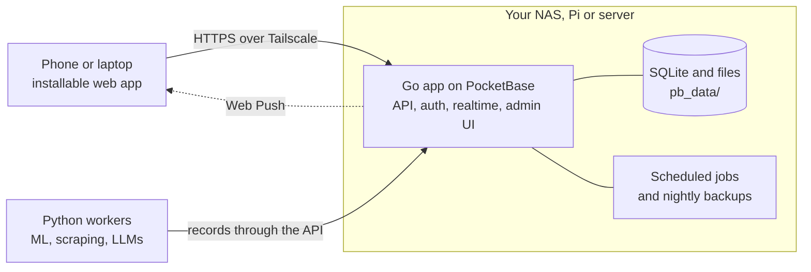

<div align="center">


# Flowy

**A private period and cycle tracker that runs on your own server.**

&nbsp;
&nbsp;


</div>

Flowy predicts your next period, fertile window and ovulation from the periods
you log, and keeps everything on your own hardware (a NAS, a Raspberry Pi, a
small server). Install it on your phone from the browser.

- **Today:** days until your period (or which day of it you're on, or how late it
  is), cycle day, chance of pregnancy, the phase you're in, and today's log.
- **Cycle chart:** this cycle as a curve of the chance of pregnancy over your period,
  fertile and ovulation days. Drag across it to look at any day.
- **Mochi:** an animated cat that naps during your period, plays, sends hearts in
  your fertile window and curls up before your next period, with a tip for each phase.
- **Calendar:** logged periods, predicted periods, fertile days and ovulation.
  Tap a day to log it, or edit period days in one go.
- **Day log:** flow, symptoms, moods, sex, pill, temperature, weight and notes. Add
  symptoms of your own with an icon; they stay in your list.
- **Insights:** average cycle and period length, how regular you are (shortest,
  longest and a chart of recent cycles), the next periods and fertile windows,
  cycle history, temperature chart, and your most common symptoms and moods with
  when in your cycle they tend to show up.
- **Share with your partner:** a private link, no account needed, showing your
  phase, when your period is due, fertile days, tips on how to support you and a
  quiz on how well they know your cycle. Optionally today's moods and symptoms.
  Renew or turn it off any time.
- **Reminders:** a push notification two days before your period, when your
  fertile window starts, and for your pill.
- **Works offline:** logs are saved on the phone and sent to the server when it
  is reachable again.
- **Locked down on the phone:** an optional PIN for the app, sign-out removes your
  logs from the phone (and warns first if some haven't reached the server), and
  "sign out on all devices" for a lost phone.
- **Private:** sign-in with email and password, each person only sees their own
  calendar (a partner link shows a summary, never your history or notes), and the data never leaves your server. Export it as CSV any time, and import days exported from another app.

Predictions are estimates, not a form of birth control.

Flowy is built on [plasto](https://github.com/kalfasyan/plasto). To run it on a
Synology NAS, follow [docs/synology.md](docs/synology.md).

## Quick start

You need [Go](https://go.dev/dl/) 1.27+, [Node](https://nodejs.org) 22+ and
[uv](https://docs.astral.sh/uv/) (for the Python workers).

```sh
make setup   # install dependencies
make dev     # backend on :8090, web app with live reload on http://localhost:5173
```

Open the app and create your account: the first person becomes the **owner**
and can also sign in to the admin UI at http://localhost:8090/_/ with the same
email and password. Add more people there, in the `users` collection.

## What you get

- **First-run setup and sign-in.** No terminal needed to create the first account.
- **Users and roles.** The owner manages everyone; members can see each other and
  edit themselves. Nobody can sign themselves up.
- **Push notifications** straight from your server, with no account or third-party
  service. Each person turns them on per device; send one from Go with
  `push.ToUser(app, userID, push.Message{Title: "…", URL: "/…"})`. Phones need the
  app on HTTPS.
- **Scheduled jobs that don't get skipped.** `jobs.MustAdd(app, "digest", "0 7 * * *", fn)`
  runs on a cron schedule in your time zone (`TZ`). If the server was off when a job
  was due, it runs once when the server starts again. Every run and its error are
  listed in the admin UI under the `jobs` collection.
- **Nightly backups** of the database and uploads at 03:00, keeping the last 7, in
  `pb_data/backups`. Change the schedule or add S3 storage in the admin UI under
  Settings > Backups.
- **Python workers** for the heavy lifting (ML, scraping, LLMs), on this machine or
  another. They sign in with a worker account and read and write records through
  the API; see [workers/README.md](workers/README.md).
- **An installable app.** It installs to a phone's home screen or a desktop, opens
  offline from its cached shell, and follows the system's light or dark mode.

## How it fits together



Everything a person sees is the web app, served by the Go app. Heavy work runs in
Python workers, here or on another machine, which write records; Go hooks react to
those records and notify people.

## Deploy

On any Linux machine with Docker (a NAS, a Raspberry Pi, a server):

```sh
curl -fsSL https://raw.githubusercontent.com/selfhostit/flowy/main/deploy/install.sh | sh
```

It asks for a Tailscale auth key, so your devices reach the app at
`https://flowy.<your-tailnet>.ts.net`, and starts it with Docker Compose. See
[docs/deploy.md](docs/deploy.md) for updates, backups, workers, Synology and the Pi.

## Layout

```
backend/            Go app on PocketBase
  main.go           entry point
  app/              routes, hooks and jobs (start here)
  jobs/             scheduled jobs with catch-up
  push/             Web Push: keys, subscriptions, sending
  migrations/       database schema as code
web/                Svelte 5 + Tailwind web app
  src/App.svelte    picks setup, sign-in or the app
  src/components/   screens; Home.svelte is where your app starts
  src/lib/          shared code (API client, session, install) and its tests
  public/           manifest, service worker and icons
workers/            Python worker kit, your workers, their tests and image
deploy/             compose files, Tailscale sidecar, install script, smoke test
docs/               decisions, the deploy guide and the first-feature guide
Dockerfile          the app's multi-arch image
Makefile            run `make` to see every command
```

## Commands

| Command      | What it does                                        |
| ------------ | --------------------------------------------------- |
| `make dev`   | Run everything with live reload                     |
| `make check` | Format, lint and type-check                         |
| `make test`  | Run the Go, web and worker tests                    |
| `make build` | Build `dist/flowy` with the web app next to it      |
| `make run`   | Build the Docker image and run it on :8090          |
| `make smoke` | Deploy both images with Compose and test end to end |

Pushes to `main` publish `ghcr.io/selfhostit/flowy` and
`ghcr.io/selfhostit/flowy-worker` for amd64, arm64 and armv7; a `v*` tag
publishes that version.

## Support

If flowy saves you time, you can [buy me a coffee](https://buymeacoffee.com/kalfasyan).

## License

MIT
